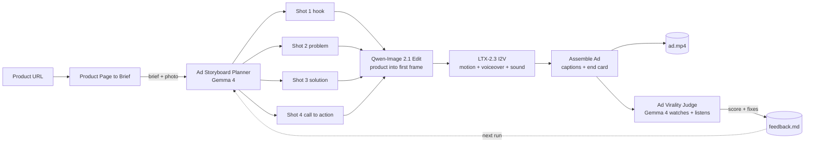

# Open Ad Factory

**Paste a product URL. Get a vertical video ad that grades itself, then gets better.**

An open-weights rebuild of Higgsfield's *Click to Ad*, as a ComfyUI node pack. Built for [Open Source Higgsfield](https://comfy.org/open-source-higgsfield/).

- **Open weights only.** Gemma 4, Qwen-Image 2.1 and LTX-2.3. No partner nodes, no API keys, nothing leaves your machine except the product page request.
- **Self-improving.** A multimodal judge watches and listens to the finished cut, scores it out of 100 on an engagement rubric, and writes concrete fixes. Press Run again and the planner rewrites the storyboard from those fixes.
- **One workflow.** URL in, 22-second 9:16 ad with voiceover, captions and an end card out, plus the social post caption and hashtags.

Every "product URL to video ad" tool we found (CutAgent, AdFlow Studio, Atlas Marketing Studio, Prizmad, and others) calls closed models (Veo, Kling, Seedance, HeyGen, ElevenLabs) through paid APIs. This one runs on your own GPU.

## How it works



1. **Product Page to Brief** reads Shopify product JSON, schema.org `Product` JSON-LD or Open Graph tags. It returns a text brief, the product photo, and the photo on a 9:16 canvas (white for studio packshots, blurred backdrop otherwise).
2. **Ad Storyboard Planner** asks Gemma 4, which also sees the product photo, for a strict JSON storyboard. Each shot gets a role (hook, problem, solution, proof, cta), a keyframe instruction, a motion prompt, a voiceover line sized to the shot length, and a caption. The storyboard also carries the end-card headline, call to action, post caption and hashtags. Invalid JSON gets one repair pass, then a clear error.
3. **Qwen-Image 2.1 Edit** turns the canvas into each shot's first frame and keeps the exact product from `<image1>`.
4. **LTX-2.3 image to video** animates the frame and generates the voiceover and ambient sound in the same pass. Its built-in prompt enhancer sees the keyframe.
5. **Assemble Ad** joins the shots, fits each shot's audio to its frames so sound never drifts, burns in captions, and adds an end card with the headline and call to action.
6. **Ad Virality Judge** gives Gemma 4 the video (1 frame per second) and the audio. It scores 7 criteria from 0 to 10: hook (weight 25), product clarity (20), message (15), pacing (15), audio (10), CTA (10), visual quality (5). The 0-100 score is a fixed weighted sum computed in Python, so runs are comparable. The rubric follows what drives short-video engagement in the SnapUGC study (ECCV 2024): an early hook, a clear subject, pacing and audio.

The Qwen-Image and LTX stages are Comfy's own template subgraphs, copied as-is, so their samplers, LoRAs and upscalers are the ones Comfy tuned.

## The improvement loop

The planner and the judge share a **project** name. After each run, `ComfyUI/output/open_ad_factory/<project>/` holds:

| File | What |
|---|---|
| `storyboard.json` | The storyboard of the last run |
| `review.json` | The judge's scores, strengths and fixes |
| `feedback.md` | The fixes the planner reads next time |
| `history.jsonl` | One line per run with the score, so you can watch it climb |

The planner only re-runs when `feedback.md` changes, so ComfyUI's cache still skips work that has not changed. Turn off `use_judge_feedback` to plan from scratch.

## Install

```bash
cd ComfyUI/custom_nodes
git clone https://github.com/kaili-yang/comfyui-open-ad-factory
```

No extra Python dependencies. Needs a ComfyUI recent enough to have `TextGenerate` (Gemma 4), Qwen-Image 2.1 and LTX-2.3 support. It was built against ComfyUI `d07dff45` and frontend `1.57.1`.

Then open **Templates → Custom nodes → comfyui-open-ad-factory → open_ad_factory**.

### The ad for this repo, made by this repo

`example_workflows/open_ad_factory_self_ad.json` points Open Ad Factory at its own GitHub page. The product is the app on a phone (`assets/open_ad_factory_hero.png`, drawn by `tools/make_hero.py`), the style is `playful`, and the project is `open_ad_factory_self_ad`.

1. Copy `assets/open_ad_factory_hero.png` into `ComfyUI/input/`, or drop it onto the *Product photo* node.
2. Open **Templates → comfyui-open-ad-factory → open_ad_factory_self_ad** and press **Run**.
3. Press **Run** again to let the planner apply the judge's fixes.

## Models

| Stage | Files | Folder |
|---|---|---|
| Planner + judge | [gemma4_e4b_it_fp8_scaled.safetensors](https://huggingface.co/Comfy-Org/gemma-4/resolve/main/text_encoders/gemma4_e4b_it_fp8_scaled.safetensors) | `text_encoders` |
| Keyframes | Same files as the official *Image Edit (Qwen Image 2.1)* template ([Comfy-Org/Qwen-Image-2.1](https://huggingface.co/Comfy-Org/Qwen-Image-2.1)) | see template |
| Video + voice | Same files as the official *LTX-2.3 Image to Video* template ([Comfy-Org/ltx-2.3](https://huggingface.co/Comfy-Org/ltx-2.3)) | see template |

The whole graph loads three model families one after another, so plan for a large GPU or a cloud machine. ComfyUI offloads between stages.

## Nodes

| Node | Inputs | Outputs |
|---|---|---|
| **Product Page to Brief** | `url`, `image_index`, canvas `width`/`height`, `background`, `extra_notes`, optional `image` | `brief`, `product_image`, `canvas` |
| **Ad Storyboard Planner** | `clip` (Gemma 4), `brief`, `product_image`, `num_shots` 3-5, `seconds_per_shot`, `style` (ugc, cinematic, playful, minimal), `audience`, `language`, `project`, `use_judge_feedback`, `seed` | `storyboard`, `summary`, `post_caption` |
| **Ad Shot** | `storyboard`, `shot` | `keyframe_prompt`, `video_prompt`, `caption` |
| **Assemble Ad** | `storyboard`, `product_image`, `video_1`…`video_5`, `captions`, `caption_position`, `end_card_seconds`, `font_path` | `video` |
| **Ad Virality Judge** | `clip` (Gemma 4), `video`, `storyboard`, `project`, `save_feedback`, `seed` | `score`, `report`, `feedback` |

## Tips

- Keep `seconds_per_shot` on the planner equal to `duration` on the LTX nodes. The voiceover length is sized from it.
- If a site blocks scrapers, leave `url` empty, connect your own photo to `image`, and describe the product in `extra_notes`.
- Captions use the bundled Anton font (SIL OFL). For Chinese, Japanese or Korean captions, set `font_path` to a font that covers them.
- For 3 or 5 shots, change `num_shots` and add or remove a Shot → Qwen → LTX branch.

## Development

```bash
# unit + node tests (node tests run the real node classes with a fake LLM; they need ComfyUI at ../ComfyUI or COMFYUI_PATH)
python -m pytest tests

# rebuild the example workflow from the installed official templates, then validate it in the real frontend
python tools/build_workflow.py --server http://127.0.0.1:8188
PLAYWRIGHT_DIR=/path/to/ComfyUI_frontend node tools/validate_workflow.mjs build/raw_workflow.json example_workflows/open_ad_factory.json
```

`validate_workflow.mjs` loads the workflow in a headless ComfyUI frontend, converts it to an API prompt, checks that the shot prompts, sizes and durations reach the LTX and Qwen internals, and submits it for server validation. On a machine without the models, the only allowed errors are missing model files.

## License

MIT. Model weights keep their own licenses: Gemma (Gemma Terms of Use), Qwen-Image 2.1, and LTX-2.3 (LTX community license). The Anton font is SIL OFL 1.1, see `open_ad_factory/fonts/OFL.txt`.
